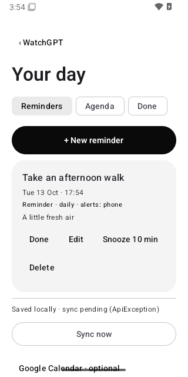
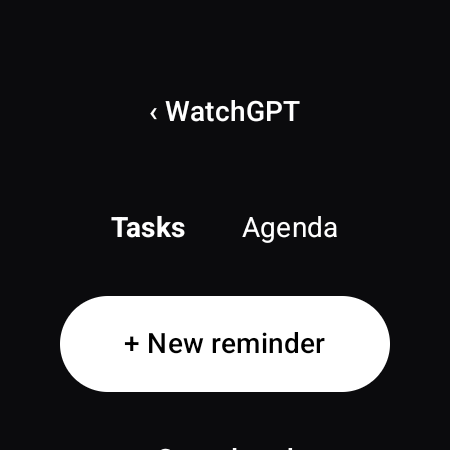
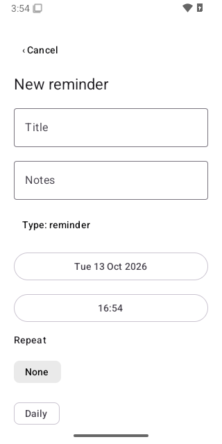
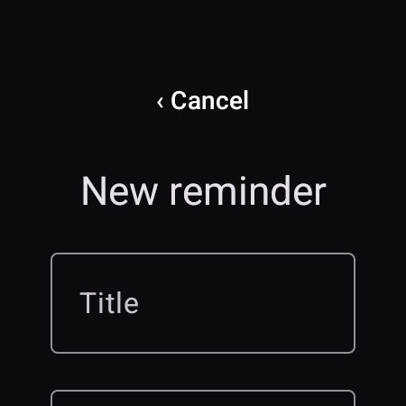
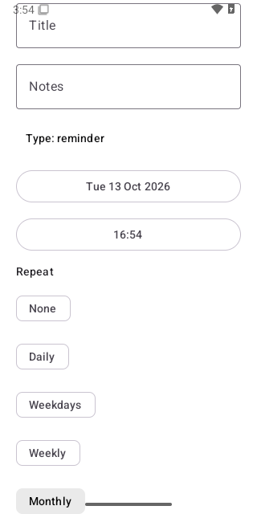
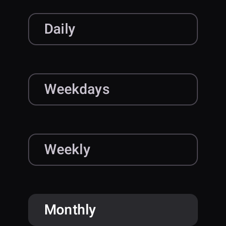
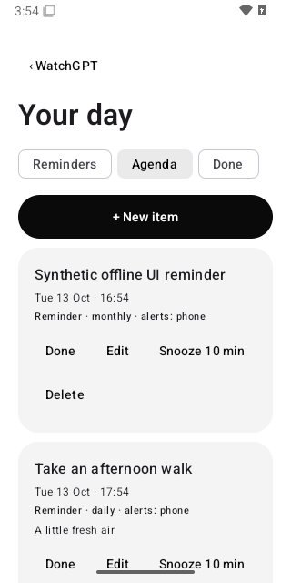
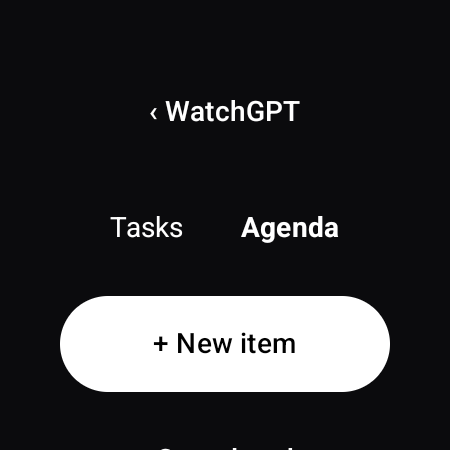
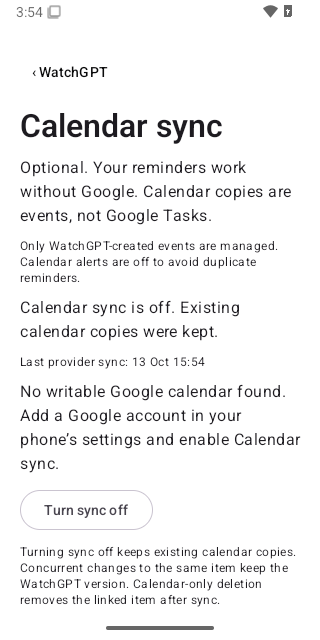

# WatchGPT screen previews

These are captures of the implemented Compose interfaces, using synthetic reminders and events. Phone captures run in an Android 15 emulator. Watch captures exercise the same watch layout code at 450 × 450 pixels and 225 dp; they are layout previews, not photographs or physical Watch9 test results. Release apps protect private screens from capture.

| Phone | Watch layout |
| --- | --- |
|  |  |
|  |  |
|  |  |
|  |  |

The calendar screen shows its unconfigured state. No real Google account, ChatGPT session, user reminders, or credentials are used in these captures.
